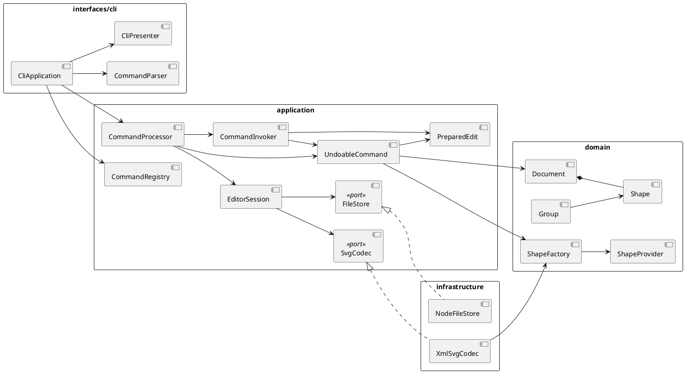

# PJ1 Phase 1：SVG 编辑器架构方案

> 本文档是 Phase 1 的架构基线。实现完成后，需按实际代码更新“一致性自查”。

## 1. 架构目标

项目采用分层架构，以 **Command** 作为所有编辑行为的统一入口，以 **Composite** 表示 SVG 图形树，以**反向命令**实现 undo/redo。

- CLI、未来的 GUI 或智能体入口复用同一套编辑能力。
- 一条编辑命令对应一个 undo 单元，命令成功后才进入历史栈。
- `<g>` 与叶子图形统一支持 `move`、`scale`、`set`、`delete` 等操作。
- `domain` 不依赖 CLI、XML 或文件系统，并通过 Provider/Port 提供扩展点。
- 本阶段实现 `rect`、`circle`、`ellipse`、`line`、`text`、`g`；插件类型 `box` 暂不实现。

## 2. 模块划分

计划目录如下，具体文件名可在实现中微调，但职责和依赖方向应保持稳定：

```text
src/
  domain/
    model/          # Document、id 索引、父子关系和不变量
    geometry/       # 坐标、尺寸和变换
    shapes/         # Shape、Group 及各叶子图形
    extensions/     # ShapeProvider、ShapeFactory
  application/
    EditorSession.ts
    commands/       # ExecutableCommand、UndoableCommand 及具体命令
    history/        # CommandProcessor、CommandInvoker
    extensions/     # CommandProvider、CommandRegistry
    ports/          # SvgCodec、FileStore
  infrastructure/
    svg/            # XML/SVG 解析、映射和序列化
    fs/             # 文件系统实现
  interfaces/
    cli/            # REPL、参数解析和结果展示
  bootstrap/        # 注册内置 Provider 并组装依赖
tests/
```

各模块职责：

| 模块 | 职责 | 不应承担 |
|---|---|---|
| `domain/model` | 文档、id 索引、父子关系和结构不变量 | 文件 IO、参数解析、输出 |
| `domain/geometry` | 坐标、尺寸和数值规则 | XML 或 CLI 格式 |
| `domain/shapes` | Composite 结构、图形属性和递归操作 | 历史栈、命令分发 |
| `application/commands` | 校验、执行编辑操作及反向恢复 | 打印结果、读取文件 |
| `application/history` | 执行命令、维护 undo/redo 和历史门禁 | 具体图形几何逻辑 |
| `application/ports` | SVG 编解码与文件读写接口 | Node.js 等具体实现 |
| `infrastructure` | 实现 XML/SVG、文件系统等外部能力 | 绕过 Command 修改文档 |
| `interfaces/cli` | 输入解析和结果格式化 | 保存图形状态、实现撤销 |
| `bootstrap` | 注册实现并完成依赖注入 | 业务规则 |

包图：



## 3. 设计模式与落地

### 3.1 Command 与反向命令

所有编辑操作实现统一接口：

```typescript
interface UndoableCommand {
  readonly kind: "edit";
  prepare(context: CommandContext): PreparedEdit;
}

interface PreparedEdit {
  apply(context: CommandContext): CommandResult;
  revert(context: CommandContext): CommandResult;
}
```

命令由 `CommandProvider` 创建，CLI 不直接修改文档：

```text
CLI -> CommandParser -> CommandRegistry -> CommandProcessor
    -> 编辑命令：CommandInvoker -> prepare -> PreparedEdit.apply
    -> 文档/查询/控制命令：处理器直接执行
```

`CommandResult` 包含成功状态、消息和受影响 id，命令本身不直接输出文本。这样后续增加 GUI 或智能体入口时，无需重写应用逻辑。

`CommandInvoker` 只保存已经准备好的 `PreparedEdit`，不保存整份文档快照：

```text
execute：command.prepare() -> edit.apply() -> 压入 undo 栈并清空 redo 栈
undo：edit.revert() 成功后，将 edit 移入 redo 栈
redo：edit.apply() 成功后，将 edit 移回 undo 栈
```

每条命令保存恢复所需的局部信息：

| 命令 | 反向恢复信息 |
|---|---|
| `create` | 新图形 id；撤销时删除该图形 |
| `delete` | 被删除子树、原父节点和原索引 |
| `move` / `scale` | 每个受影响图形修改前的实际几何值 |
| `set` | 原属性值和新值 |
| `group` / `ungroup` | 原父节点、索引、成员顺序和组 id |
| `addto` | 原父节点、原索引、目标容器和目标索引 |
| `front` / `back` | 原同级顺序或原索引 |

`scale` 的 undo 恢复记录的原值，而不是只乘 `1/factor`，避免浮点漂移。

### 3.2 命令原子性

所有编辑命令遵循 `prepare -> PreparedEdit.apply`：

1. `prepare` 检查 id、容器类型、数值、属性和结构规则。
2. `prepare` 同时生成包含目标和反向信息的 `PreparedEdit`。
3. `apply` 完成不会被业务规则拒绝的修改。

例如 `group` 必须在修改结构前检查所有成员存在、没有祖先后代冲突，并生成包含每个成员原父节点和索引的 PreparedEdit。任何准备失败时，文档和历史栈都不改变。

### 3.3 Composite

```text
Shape
├── LeafShape：Rect、Circle、Ellipse、Line、Text
└── Group：children: Shape[]
```

`Group` 递归执行标准操作，因此命令只面向 `Shape`。Composite 负责结构和递归，Command 负责用户操作及撤销；结构命令通过 `Document` 或 `Group` 的受控方法修改父子关系。

### 3.4 Provider 与 Port

- `ShapeProvider` 根据类型创建领域图形；SVG 的标签和属性先由基础设施映射成不含 XML 类型的初始化参数。
- `CommandProvider` 提供命令解析、帮助信息和命令创建能力。
- `SvgCodec` 和 `FileStore` 隔离 XML 与文件系统。
- 内置类型也在 `bootstrap` 中注册，后续 `box` 插件复用同一路径。
- `ShapeVisitor` 负责与图形类型相关的输出，目前用于 `tree` 格式化，避免在展示层散落图形类型判断。

按名字分派仅允许以下两处，均标记为待重构：

| 位置 | 分派内容 | 后续方向 |
|---|---|---|
| `CommandRegistry` | 命令名 → `CommandProvider` | 改为元数据驱动，允许插件注册命令 |
| `ShapeFactory` | 图形类型名 → `ShapeProvider` | 改为完整插件注册表，支持自定义复合类型 |

## 4. 命令分类与历史规则

| 类别 | 命令 | 历史规则 |
|---|---|---|
| 文档命令 | `init`、`read`、`save`、带参 `canvas` | 成功后清空历史，并在下一次编辑命令前禁止 undo/redo |
| 编辑命令 | `create`、`delete`、`move`、`scale`、`set`、`group`、`ungroup`、`addto`、`front`、`back` | 每个命令对象是一个历史单元 |
| 显示命令 | `tree`、`show`、`help` | 不进入历史栈 |

`EditorSession` 统一维护当前文档和历史门禁，CLI 不保存这些状态。

## 5. 依赖方向

允许的依赖：

| 来源 | 可以依赖 |
|---|---|
| `interfaces/cli` | `application` |
| `application` | `domain`、应用层 ports |
| `infrastructure` | 应用层 ports、`domain` 模型 |
| `bootstrap` | 所有模块，仅用于组装 |

禁止出现以下依赖：

- `domain` 导入 CLI、XML、Node.js 文件系统或其他外层模块。
- 命令直接打印输出或读写文件。
- CLI 绕过 `EditorSession` 修改 `Document`。
- 图形持有历史栈，或通过全局可变单例取得文档。
- 在解析器、CLI 和序列化器中重复写图形类型分派。

任何违反规则的依赖都记为待处理项，并记录修订原因。

## 6. 变化点与预留

| 变化点 | 预留方式 | 本阶段决定 |
|---|---|---|
| 增加图形或 `box` 插件 | `ShapeProvider`、`ShapeFactory`、Composite | 不实现插件加载器，但内置类型走同一注册路径 |
| 增加命令或输入入口 | `CommandProvider`、`CommandResult`、Presenter 分离 | 不提前引入事件总线 |
| SVG 元素、transform 或命名空间变化 | `SvgCodec`、`Transform`、SVG 映射器 | 不把任意 XML 节点放入领域模型 |
| 大文档使反向信息过多 | 命令只保存受影响对象的局部状态 | 先用测试测量，再考虑差异存储 |
| undo 历史持久化 | 历史层只依赖 `UndoableCommand` | 当前单进程 CLI 不持久化历史 |
| 外部 SVG 缺 id 或 id 冲突 | `DocumentIndex` 在导入阶段统一处理 | 不在每条命令内重复补 id 和警告 |

## 7. 过程记录

1. 最初考虑用 Memento 保存整份 `Document` 快照。由于项目要求反向命令和较高扩展性，最终改为每条命令保存局部恢复信息。
2. 确认 Composite 只负责结构递归，结构修改仍由 `group`、`ungroup`、`addto` 等命令统一触发，以保证一次操作对应一个 undo 单元。
3. 为使“可扩展”可以验证，决定内置命令和图形也经过 Provider 注册，而不是只给插件保留未使用的接口。

## 8. 一致性自查

实现后逐项检查，未完成前不得勾选：

- [ ] 实际目录与本文档一致，差异已记录。
- [ ] 命令名和图形类型分别只在 `CommandRegistry`、`ShapeFactory` 分派。
- [ ] `domain` 不依赖 CLI、XML 或文件系统。
- [ ] CLI 只通过 `EditorSession` 编辑文档。
- [ ] `Group` 与叶子图形支持相同的标准操作。
- [ ] 每条编辑命令都有 `prepare -> apply -> revert -> apply` 测试。
- [ ] 结构命令能恢复原父节点、成员顺序和 z-order。
- [ ] 失败命令不改变文档和历史栈。
- [ ] 文档命令后的 undo/redo 门禁符合要求。

一致性抽查至少覆盖 `CreateShapeCommand`、`GroupCommand`、`UngroupCommand`、`DeleteShapeCommand` 以及 CLI 到 `EditorSession` 的调用链。

## 9. 质量保证

- **领域测试**：id 唯一性、父子关系、递归移动/缩放、属性校验和非法结构。
- **命令测试**：准备失败不改变状态；所有命令完成 prepare/apply/revert 往返；结构位置准确恢复。
- **SVG 测试**：元素 round-trip、缺 id 补全、容器嵌套、属性省略语义。
- **端到端测试**：回放作业中的完整 transcript，检查成功和错误输出。
- **依赖检查**：用导入检查或 CI 脚本确认领域层未依赖外层模块。

关键验收场景包括容器移动与撤销、`group`/`ungroup` 后顺序恢复、删除容器后子树恢复、`front/back` 撤销、缩放无浮点漂移、SVG 保存后在浏览器打开并能正确读回。

建议按“架构和骨架、领域模型、Command/History、结构命令、CLI、SVG、最终自查”的顺序提交。全部功能、测试和文档完成后，才创建并推送 `final` tag。
