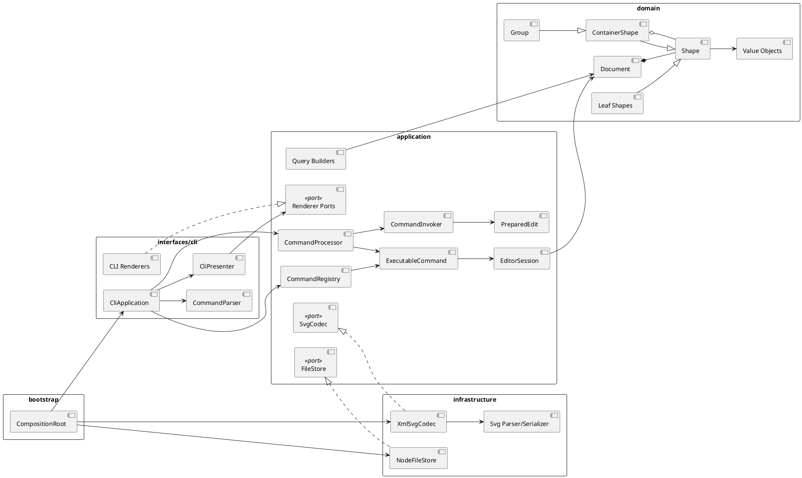

# PJ1 Phase 1：SVG 编辑器

## 1. 架构方案

### 1.1 架构目标

项目采用分层架构：

- **Command** 是所有编辑行为的唯一入口，CLI 不直接修改文档。
- 编辑命令使用 **PreparedEdit 反向操作**实现 undo/redo，不使用整文档快照。
- **ContainerShape + Composite** 统一表示图形树。
- Document 是已挂载树、id 索引和 shapeCount 的唯一所有者。
- SVG、文件系统和 CLI 通过 Port/Adapter 与核心逻辑隔离。
- 内置命令和图形也通过 Provider 注册。
- tree/show 返回结构化 Snapshot，CLI 只负责排版。

Phase 1 实现 `rect`、`circle`、`ellipse`、`line`、`text`、`g`。`box` 属于后续插件阶段，本阶段返回未注册类型错误。

### 1.2 模块划分

```text
src/
  domain/
    model/          # Document、CanvasSize、ShapePlacement
    shapes/         # Shape、ContainerShape、Group、叶子图形、
                    # Point、Size、ShapeId、ShapeStyle 等值对象
  application/
    EditorSession.ts
    commands/       # Command、PreparedEdit、具体命令和 ShapeFeedback
    history/        # CommandProcessor、CommandInvoker
    extensions/     # CommandProvider、CommandRegistry
    queries/        # Tree/ShapeDetails Snapshot 和 Builder
    shapes/         # ShapeInit、ShapeProvider、ShapeFactory、providers
    ports/          # SvgCodec、FileStore、Renderer Ports
  infrastructure/
    svg/            # XmlSvgCodec、Parser、Serializer、IdAllocator、Transform
    fs/             # NodeFileStore
  interfaces/
    cli/            # REPL、Parser、Presenter 和具体 Renderer
  shared/errors/    # UserFacingError、UserInputError、CommandRejectedError
  bootstrap/        # CompositionRoot
  main.ts
tests/
  application/ commands/ domain/ infrastructure/
  interfaces/ shapes/ e2e/ support/
```

| 模块 | 职责 | 不承担 |
|---|---|---|
| `domain/model` | Document、画布尺寸、id 索引、父子关系、挂载状态 | CLI、XML、文件 IO |
| `domain/shapes` | Composite、图形操作、值对象和领域不变量 | 历史栈、命令分发 |
| `application/commands` | 准备、应用和反向执行操作 | 打印文本、直接访问 Node.js fs |
| `application/history` | 命令分类执行、历史栈和门禁 | 具体图形几何规则 |
| `application/queries` | 构建结构化 tree/show 结果 | CLI 排版 |
| `application/shapes` | Provider 注册、统一创建和公共样式应用 | 具体图形几何实现 |
| `application/ports` | SVG、文件和展示输出抽象 | 具体外部实现 |
| `infrastructure` | XML/SVG、文件系统、原子写入 | 修改命令历史 |
| `interfaces/cli` | REPL、参数解析、Snapshot 排版 | 保存领域状态 |
| `shared/errors` | 用户错误与内部异常分类 | 业务规则 |
| `bootstrap` | 注册实现并组装依赖 | 业务决策 |

### 1.3 包图



CompositionRoot 是唯一同时认识所有具体实现的组装位置。

### 1.4 设计模式与落地

#### Command + 反向命令

```typescript
interface UndoableCommand<TContext> {
  readonly kind: "edit";
  prepare(context: TContext): PreparedEdit<TContext>;
}

interface PreparedEdit<TContext> {
  apply(context: TContext): CommandResult;
  revert(context: TContext): CommandResult;
}
```

执行流程：

```text
CLI -> CommandParser -> CommandRegistry -> CommandProcessor
    -> 编辑命令：CommandInvoker -> prepare -> PreparedEdit.apply
    -> 文档/查询/控制命令：直接执行
    -> CommandResult/CommandView -> CliPresenter
```

CommandInvoker 只保存 PreparedEdit：

```text
execute：prepare -> apply -> 入 undo 栈并清空 redo
undo：revert 成功 -> 移入 redo 栈
redo：apply 成功 -> 移回 undo 栈
```

反向信息均为局部状态：

| 操作 | 反向信息 |
|---|---|
| create | 新图形、父容器、插入索引 |
| delete | 被删除子树、原父容器、索引 |
| move/scale | 受影响图形的 GeometryState |
| set | 修改前属性值 |
| group/ungroup | 原父节点、索引、成员顺序、原容器 |
| addto | 原父节点、原索引、目标容器 |
| front/back | 原同级索引 |

所有编辑命令遵循 `prepare -> apply`：易失败条件在 prepare 阶段检查，apply 只提交已准备好的修改。经验证，操作失败不会写入历史或改变文档。

#### Composite 与 Document 所有权

```text
Shape
├── LeafShape：Rect、Circle、Ellipse、Line、Text
└── ContainerShape
    └── Group
```

ContainerShape 统一提供 children、`walkTree`、递归 move/scale、循环检测和局部几何恢复。已挂载容器的 add/insert/remove 会被拒绝，所有结构修改必须经过 Document，以同步父子关系、id 索引、shapeCount 和 attached 状态。

#### Provider / Factory

- `ShapeProvider.createFromCliArgs` 将 CLI 参数转换为中立的 ShapeInit。
- `ShapeProvider.create(ShapeInit)` 同时服务 CLI 创建和 SVG 读取。
- ShapeFactory 集中完成类型分派、Provider 调用和公共样式应用。
- CommandProvider 提供命令名称、usage、解析和命令创建。
- 内置命令和图形在 CompositionRoot 中使用同一注册路径。

按名字分派只有两处，均标记为待重构：

| 位置 | 内容 | 后续方向 |
|---|---|---|
| CommandRegistry | 命令名 → CommandProvider | 插件元数据驱动注册 |
| ShapeFactory | 图形类型名 → ShapeProvider | 完整插件注册表 |

#### Port / Adapter 与 Snapshot

- SvgCodec 隔离 XML/SVG，XmlSvgCodec 内部拆为 Parser、Serializer、IdAllocator。
- FileStore 隔离文件系统；NodeFileStore 使用临时文件加 rename 原子保存。
- tree/show 返回 TreeSnapshot/ShapeDetailsSnapshot；Command 不依赖 CLI Renderer。
- GUI 或智能体可直接复用 Snapshot，CLI Presenter 可替换。

#### 值对象和错误分类

CanvasSize、Point、Size、ShapeId、ShapeStyle、GeometryState 保证正数、有限坐标、非空 id 和可精确恢复的局部状态。move/scale 先计算完整目标状态，再一次性提交。

UserInputError 和 CommandRejectedError 属于用户可处理错误；CLI 只格式化这些错误，TypeError 等内部故障会保留为程序缺陷。

### 1.5 依赖方向

| 来源 | 可以依赖 | 理由 |
|---|---|---|
| interfaces/cli | application、shared | CLI 是应用用例的输入输出适配器 |
| application | domain、自身 ports、shared | 编排领域逻辑，不持有外部实现 |
| domain | 仅领域内部与 shared 无外设类型 | 核心规则独立、可测试 |
| infrastructure | application ports、domain | 实现 SVG/文件系统适配器 |
| bootstrap | 所有模块 | 唯一依赖组装位置 |

禁止：

- domain 导入 CLI、Infrastructure、Node.js fs 或 XML 库。
- Command 直接打印或访问具体文件/SVG 实现。
- CLI 绕过 CommandProcessor 修改 Document。
- 已挂载 ContainerShape 绕过 Document 修改结构。
- 多处重复命令名或图形类型分派。

### 1.6 变化点与阶段边界

| 变化点 | 预留方式 | 当前决定 |
|---|---|---|
| 新增图形或 box 插件 | ShapeProvider、ShapeFactory、ContainerShape、Descriptor | 不实现插件加载器；接口已备 |
| 新增命令或输入入口 | CommandProvider、CommandProcessor、CommandView | 不引入事件总线 |
| GUI/智能体 | 命令结果与 Snapshot 不绑定文本 | CLI Presenter 可替换 |
| SVG transform/属性扩展 | Codec、Parser、Serializer、ShapeInit | 支持 translate 和等比 scale |
| 大文档历史增长 | 命令只保存局部状态 | 先测量再优化 |
| 历史持久化 | 历史层只依赖 PreparedEdit | Phase 1 不持久化 |

Phase 1 边界：

- `box` 不实现，`create box` 返回未注册类型错误。
- transform 在读取时归一化为图形坐标，保存输出规范 SVG。
- rotate、matrix、非等比 scale 明确拒绝。
- 不承诺任意外部 SVG 的未知元素和属性完整 round-trip。

## 2. 过程记录

1. 最初考虑整文档 Memento，最终按高扩展性要求改为 PreparedEdit 反向命令。
2. 发现 CreateShapeCommand 存在隐藏可变准备状态，重构为显式 `prepare -> PreparedEdit`。
3. E2E 测试发现 `addto` 后图形脱离 Document id 索引，修复为 `detach -> Document.insertShapeAt`。
4. 为从结构上避免同类问题，引入 attached 状态和 Document 唯一结构修改入口。
5. 删除中心 ShapeVisitor，改用 ShapeDescriptor、ContainerShape.walkTree 和多态 SVG 属性。
6. 将 XmlSvgCodec 拆分为 Parser、Serializer、IdAllocator，并将测试从重复编译优化为预构建一次。
7. 将 tree/show 从文本改为 Snapshot，查询和排版分离。
8. 根据文档 transcript 修正 create-in、move、tree text、show 和恢复反馈格式。
9. 加强值对象与不变量，修复 canvas 查询清空历史、未初始化 undo/redo、非原子保存、插件容器 ungroup 和 Text transform 属性问题。

## 3. 一致性自查

### 3.1 模块划分

- [x] 实际目录与本文档一致。
- [x] 修订记录覆盖值对象位置、XmlSvgCodec 拆分、queries 和 errors 模块。
- [x] 查询、Renderer 和领域模型职责已分离。
- [x] 已挂载容器结构修改统一经过 Document。

### 3.2 依赖与分派

- [x] domain 未导入 CLI、Infrastructure、Node.js fs 或 XML 库。
- [x] CLI 只通过 CommandRegistry/CommandProcessor 执行命令。
- [x] 命令名分派只集中于 CommandRegistry。
- [x] 图形类型分派只集中于 ShapeFactory。
- [x] SVG Parser 通过 ShapeFactory 创建图形。
- [x] Command 不依赖 CLI Renderer。

### 3.3 行为

- [x] 支持的编辑操作均使用 PreparedEdit。
- [x] Group 与叶子图形统一支持标准操作。
- [x] 结构命令恢复原父节点、成员顺序和 z-order。
- [x] 失败的结构修改不改变文档或历史。
- [x] 文档命令清空历史并门禁 undo/redo。
- [x] 普通 tree/show/help/canvas 查询不属于文档修改。
- [x] redo 后新编辑清空 redo 栈。
- [x] 插件复合容器可通过 canUngroup=false 禁止 ungroup。

## 4. 质量保证

截至本文档更新：

```text
npm test
Test Files  23 passed
Tests       87 passed

npm run typecheck
通过

npm run build
通过
```

测试分层：

- 领域值对象、Composite、容器挂载不变量测试。
- CommandInvoker 异常安全、undo/redo 和 redo 清空测试。
- 所有编辑命令的 prepare/apply/revert 和结构恢复测试。
- CLI 参数解析、quoted text、help 和结构化查询测试。
- SVG Parser/Serializer、IdAllocator、transform、原子文件写入测试。
- save/read round-trip、缺 id warning 测试。
- 文档完整 transcript、标准错误矩阵和单场景全功能验收测试。

关键验收能力：

- 六种 Phase 1 图形与 Group 的创建和递归编辑。
- create-in、group、ungroup、addto、front/back。
- move/scale/set/delete 的精确 undo/redo。
- canvas、save、read 和 IO 历史门禁。
- 嵌套 SVG 保存、读取和结构保持。
- translate、等比 scale、Text font-size/text-anchor round-trip。
- 缺 id 自动补全、quoted text 和含空格参数。
- 用户错误与内部异常分类。
